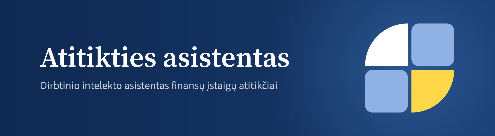
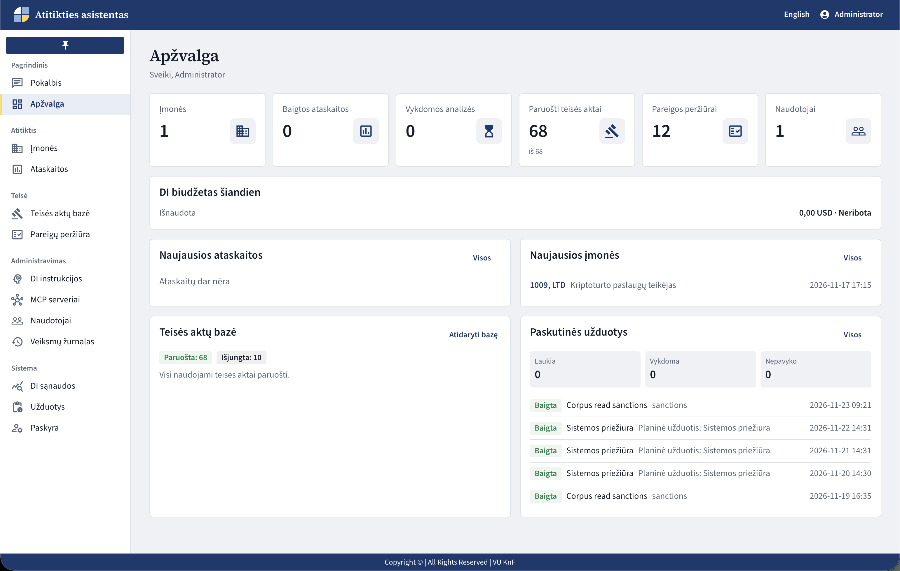

<div align="center">
  

&nbsp;

**[Diegimas](#diegimas)**
| [Pirmieji žingsniai](#pirmieji-žingsniai)
| [Dokumentacija](docs/output/lt/documentation.pdf)
| [Naudotojo vadovas](docs/markdown/lt/user-guide.md)
| [Architektūra](docs/markdown/lt/architecture.md)
| [API](docs/markdown/lt/api.md)

</div>

---

Atitikties asistentas nustato, kurie Lietuvos ir ES teisės aktai taikomi finansų įstaigai, palygina jų pareigas su įmonės dokumentais ir parengia atitikties spragų ataskaitą. Skirtas atitikties pareigūnams, teisininkams ir finansų technologijų įmonių vadovams. Sukurtas Vilniaus universiteto Kauno fakultete.

- **Pokalbis** – aprašote įmonę savais žodžiais ir įkeliate jos politikas; profilį, leidimus ir licencijas, dokumentus ir roles asistentas užpildo pats.
- **Teisės aktų bazė** – 68 Lietuvos ir ES teisės aktai iš oficialių šaltinių, suskaidyti iki straipsnio, dalies ir punkto ir tikrinami kas savaitę.
- **Atsakymai su nuorodomis** – į klausimus asistentas atsako pagal tikrus teisės aktų tekstus ir nurodo straipsnį, dalį ir punktą.
- **Spragų ataskaita** – taikomi teisės aktai, išvados su įrodymais, veiksmų planas, PDF ir „Excel“ failai.
- **Konsolė** – administratoriai joje tvarko teisės aktų bazę, pareigas, DI instrukcijas, naudotojus, veiksmų žurnalą ir DI sąnaudas.



<br/>

## Diegimas

```sh
cp docker-compose.sample.yml docker-compose.yml
touch .env && chmod 600 .env    # įrašykite eilutę AI_GATEWAY_KEY=<DI tinklų sąsajos raktas>
./runUpdateThisStack.sh         # surenka ir paleidžia sistemą
./runCreateAdmin.sh             # sukuria pirmąjį administratorių
```

Serveryje reikia tik „Docker“. Sistema veikia kūrimo režimu; gamybinį įjungia `docker-compose.yml` eilutės, pažymėtos `# Dev` ir `# Prod`. Atnaujinama komanda `git pull && ./runUpdateThisStack.sh`. Plačiau – dokumentuose [Diegimas](docs/markdown/lt/deployment.md) ir [Eksploatavimas](docs/markdown/lt/operations.md).

<br/>

## Pirmieji žingsniai

1. Prisijunkite adresu `/console`.
2. Puslapio „Teisės aktų bazė“ meniu vieną kartą pasirinkite „Perskaičiuoti visus vektorius“: paruoštoje duomenų bazėje yra teisės aktai, jų pareigos ir DI instrukcijos, bet ne vektoriai.
3. Pradėkite pokalbį: aprašykite įmonę ir įkelkite jos politikas.
4. Paprašykite spragų analizės. Asistentas pirma parodys, kuriuos teisės aktus vertins; jums patvirtinus sąrašą, parengs ataskaitą.

Visa kita – [naudotojo vadove](docs/markdown/lt/user-guide.md).

<br/>

## Teisės aktai

- **ES** (CELLAR, suvestinės redakcijos lietuvių kalba) – MiCA, DORA, GDPR, Dirbtinio intelekto aktas, NIS2, PSD2, pinigų plovimo prevencijos reglamentas ir direktyva, MiCA ir DORA techniniai standartai ir kiti.
- **Lietuva** (e-tar, galiojanti redakcija) – Finansų įstaigų, Bankų, Mokėjimų, Pinigų plovimo ir teroristų finansavimo prevencijos, Kriptoturto rinkų, Kibernetinio saugumo ir kiti įstatymai, Lietuvos banko nutarimai ir nurodymai.
- **Priežiūros institucijos** – Lietuvos banko atitikties funkcijos gairės ir licencijavimo puslapiai, EBA pinigų plovimo ir teroristų finansavimo rizikos veiksnių gairės.

Visą sąrašą rasite svetainės puslapyje „Teisės aktai“.

<br/>

## Dokumentacija

Visa sistema aprašyta vienoje knygoje – [lietuviškai](docs/output/lt/documentation.pdf) ir [angliškai](docs/output/en/documentation.pdf); veikiančioje sistemoje ją atveria svetainės puslapis „Dokumentacija“. Kiti dokumentai abiem kalbomis surašyti [docs/README.md](docs/README.md).
